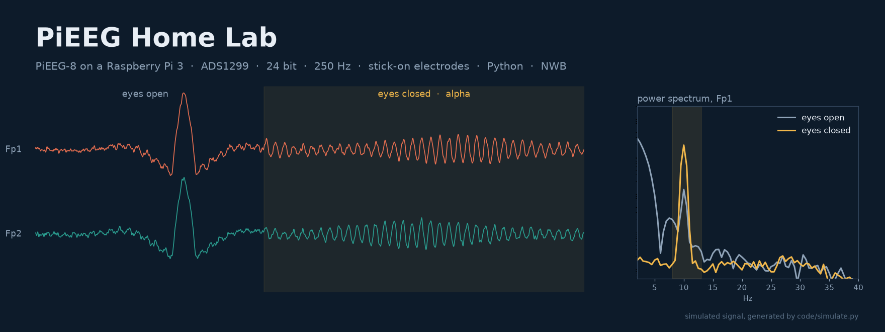
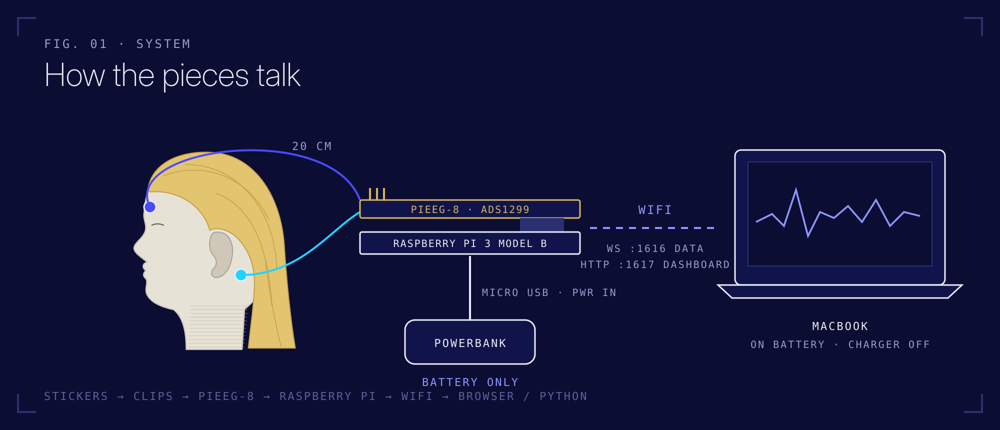
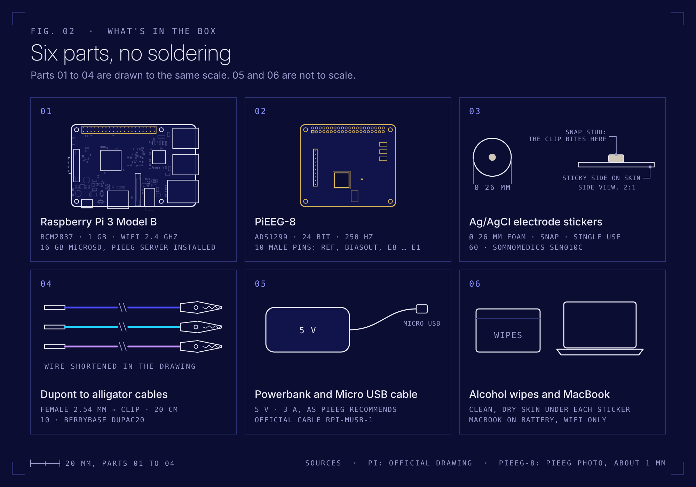

<div align="center">



[](LICENSE)


**An EEG lab on a Raspberry Pi. Stick, clip, plug in, see your brain.**

[Equipment](docs/equipment.md) · [Step by step](#step-by-step) · [How it works](docs/how-it-works.md) · [Code](#code) · [Missions](docs/missions.md) · [Troubleshooting](docs/troubleshooting.md)

</div>

---

## Contents

1. [Overview](#overview)
2. [Equipment](#equipment)
3. [Safety](#safety)
4. [Step by step](#step-by-step): from the box to your first alpha wave
5. [Code](#code): live view, recording and analysis on the MacBook
6. [Missions](#missions)
7. [Repository structure](#repository-structure)
8. [References and citation](#references-and-citation)

---

## Overview

This kit records EEG with the open source **[PiEEG-8](https://docs.pieeg.com/hardware/devices/pieeg-8/)** shield, built around the Texas Instruments **ADS1299**, the same 24 bit biopotential converter used in OpenBCI and many research amplifiers. The Raspberry Pi runs **[PiEEG Server](https://github.com/pieeg-club/PiEEG-server)** and streams 250 samples per second over WiFi. Everything else happens on the MacBook: a browser dashboard for the first look, and Python for live plots, recording, spectral analysis and conversion to the **[NWB](https://www.nwb.org/)** research data standard.

There's no EEG cap in this kit on purpose. It starts with stick-on electrodes on skin without hair (forehead and behind the ears), which is enough for blinks, eye movements, muscle activity and the alpha rhythm. More channels on bare skin (temples, eye corners) are [Mission 4](docs/missions.md#mission-4-more-channels-on-bare-skin). Positions through hair need dry electrodes, a later upgrade.



| | |
|---|---|
| Channels | 8 + Reference + Bias available, 1 to 2 used to start (Fp1, Fp2) |
| Resolution / rate | 24 bit, 250 Hz |
| Electrodes | Ag/AgCl stick-on, forehead and mastoids |
| Power | Battery only (powerbank) |
| Analysis | Python 3.10+, NumPy, SciPy, Matplotlib, PyNWB |

---

## Equipment



| # | Part | Spec | Source |
|---|---|---|---|
| ① | **Raspberry Pi 3 Model B** + 16 GB MicroSD | BCM2837, 1 GB, 2.4 GHz WiFi, set up with PiEEG Server | own |
| ② | **PiEEG-8 board** | ADS1299, 24 bit, 250 Hz, 8 ch + Ref + Bias, 2.54 mm male header | [Elecrow](https://www.elecrow.com/pieeg.html) |
| ③ | **Ag/AgCl electrode stickers**, 60 pcs | 2.6 cm foam, snap button, single use | [Somnomedics SEN010C](https://shop.somnomedics.de/en/Single-adhesive-electrode-Ag-AgCl-foam-2.6-cm-OE/SEN010C) |
| ④ | **Dupont to alligator clip cables**, 10 pcs | female 2.54 mm ↔ clip, 20 cm | [BerryBase DUPAC20](https://www.berrybase.de/en/10pin-jumper/dupont-kabel-female-krokodilklemme-trennbar-20cm?c=338) |
| ⑤ | **Powerbank** + official Micro USB cable | 5 V, 2.5 A or more (PiEEG recommends 3 A) | [BerryBase RPI-MUSB-1](https://www.berrybase.de/search?search=raspberry+pi+micro+usb+kabel) |
| ⑥ | Alcohol wipes | skin prep | dm |

<p>


</p>
<sub>Left and right: PiEEG-8, photos by PiEEG (<a href="https://docs.pieeg.com/hardware/devices/pieeg-8/">official documentation</a>). Middle: the Raspberry Pi in this kit.</sub>

What each part does and why it was chosen: **[docs/equipment.md](docs/equipment.md)**

---

## Safety

> [!CAUTION]
> **Battery only.** The PiEEG-8 has **no electrical isolation**. While electrodes are on your skin, the Raspberry Pi runs from a **powerbank that is not charging**, and the MacBook runs **on battery, charger unplugged**. No wall power, no HDMI and no Ethernet cable anywhere in the setup. [docs/safety.md](docs/safety.md)

> [!WARNING]
> **Pacemaker or other implanted electronic device?** Don't wear the electrodes without your physician's approval (PiEEG safety rule). You can still do everything as the researcher: [record someone else](docs/recording-someone-else.md) and start with [PiEEG's real example data](docs/missions.md#mission-0-real-data-first).

> [!NOTE]
> PiEEG is a research and education tool, **not a medical device**. Nothing it shows is a diagnosis.

---

## Step by step

The MicroSD is already prepared ([how it was done](docs/setup-raspberry-pi.md)). "You" below is whoever wears the electrodes. The researcher and the participant can be two different people, see [recording someone else](docs/recording-someone-else.md). From opening the box to the first alpha wave takes about 10 minutes. These steps follow the official [PiEEG-8 How to Start](https://docs.pieeg.com/hardware/devices/pieeg-8/setup/), adapted to this kit.

### Step 1 · Mount the board

Pi unplugged. Line the PiEEG-8 up with the 40 pin header so it sits over the Pi, then press it straight down until every pin is seated.


<sub>Correctly mounted. Photo: PiEEG.</sub>

### Step 2 · Place the electrodes

Wipe the skin with an alcohol wipe and let it dry. Then three stickers:

| Sticker | Position | Name |
|---|---|---|
| Left forehead, two fingers above the eyebrow | front left | **Fp1** |
| Bony bump behind the left ear | left mastoid, M1 | **Ref** |
| Bony bump behind the right ear | right mastoid, M2 | **Bias** |

PiEEG's official setup puts Ref and Bias on ear clips at the earlobes. A sticker doesn't fit an earlobe, so this kit uses the mastoids right behind them, the other standard EEG reference site.


### Step 3 · Connect the cables

Black female end of the cable onto the pin, alligator clip onto the metal snap in the middle of the sticker.


| Pin on the board | Clip goes to |
|---|---|
| **E1** | left forehead (Fp1) |
| **Ref** | behind left ear |
| **Biasout** | behind right ear |
| E2 | optional: right forehead (Fp2) |
| E3 to E8 | empty |

### Step 4 · Position and power

The cables are 20 cm, so the Pi goes close to your head: shoulder, a shelf at head height, or the pillow if you lie down. Plug the Micro USB cable into **PWR IN** and into the powerbank (charged, and not plugged into the wall). The LED on the PiEEG-8 lights up.


<sub>Image: PiEEG.</sub>

Wait about a minute while the Pi boots and joins the WiFi.

### Step 5 · Self-test the board (optional)

On the MacBook, after the [code setup](#code):

```bash
python self_test.py
```

Runs PiEEG's official noise check: the ADS1299 shorts its own inputs and measures what's left. Every channel under 5 µV RMS means the board is healthy, whatever the stickers are doing.

### Step 6 · Open the dashboard

On the MacBook (charger unplugged, same WiFi) open **[http://raspberrypi.local:1617](http://raspberrypi.local:1617)** in Safari or Chrome and click **Connect**. Then:

1. Check it shows **8 channels** (16 means the server isn't in PiEEG-8 mode, see [troubleshooting](docs/troubleshooting.md#pieeg-server)).
2. **Bandpass** → **Enabled** (default 1 to 40 Hz).
3. **Notch** → choose **50 Hz** → **Enabled**. The dashboard defaults to 60 Hz, Germany runs at 50 Hz.


<sub>PiEEG Server dashboard. Screenshot: PiEEG, <a href="https://docs.pieeg.com/hardware/devices/pieeg-8/software/">official documentation</a>. With one electrode, only channel 1 shows a real signal. Channels 2 to 8 are empty inputs and look like noise.</sub>

### Step 7 · Check the signal

Sit still, relax your face, look at one point.

| Test | What you should see on channel 1 |
|---|---|
| Sit still, eyes open | A small wiggly line, roughly ±10 to ±50 µV |
| Blink hard | A large slow spike, often 100 µV or more |
| Look left, then right | Slow steps up and down: eye movement (EOG) |
| Clench your jaw | A burst of fast noise: muscle (EMG), not brain |
| Close your eyes, relax 20 to 30 s | A rhythm around 10 Hz and a peak at 8 to 13 Hz in the spectrum: **alpha** |

Alpha is strongest at the back of the head. On the forehead it's weaker, so give it time and watch the spectrum rather than the raw line. Full checklist: **[docs/first-test.md](docs/first-test.md)**. Something off: **[docs/troubleshooting.md](docs/troubleshooting.md)**.

### Step 8 · Finish

Unplug the powerbank, peel off the stickers (single use), then recharge the powerbank with nothing connected to it.

---

## Code

The Pi handles the hardware. Your Python runs on the MacBook and reads the live stream over WiFi.

### Setup (once)

```bash
python3 --version          # 3.10 or newer
```

If it's older or missing, install Python 3.12 from [python.org](https://www.python.org/downloads/macos/) or with `brew install python@3.12`.

```bash
git clone https://github.com/jurecerkez-code/pieeg-home-lab.git
cd pieeg-home-lab/code
python3 -m venv .venv
source .venv/bin/activate
pip install -r requirements.txt
```

> [!IMPORTANT]
> The first time Python connects to the Pi, macOS asks **"Allow Python to find devices on your local network?"** Click **Allow**. Missed it? System Settings → Privacy & Security → Local Network → turn on Terminal.

### Run

```bash
source .venv/bin/activate
python live_view.py                                     # live traces + running spectrum (channels 1 and 2)
python record.py --seconds 60 --label eyes_open         # → recordings/*.csv + .json (add --subject sub-02 for someone else)
python record.py --seconds 60 --label eyes_closed
python spectrum.py recordings/*eyes_open.csv recordings/*eyes_closed.csv
```

### Without hardware

Real recordings from PiEEG, converted to this repo's format:

```bash
python get_example_data.py                                   # → recordings/example_*.csv
python spectrum.py recordings/example_*.csv
```

Or a live simulated stream:

```bash
python simulate.py                     # Terminal tab 1: fake PiEEG (alpha, blinks, 50 Hz hum)
python live_view.py --host localhost   # Terminal tab 2 (⌘T)
```

| Script | Purpose |
|---|---|
| [`eeg_stream.py`](code/eeg_stream.py) | Client for the PiEEG Server WebSocket stream (`ws://raspberrypi.local:1616`) |
| [`live_view.py`](code/live_view.py) | Live band-pass filtered traces and a Welch spectrum |
| [`record.py`](code/record.py) | Record to CSV with a JSON metadata sidecar |
| [`spectrum.py`](code/spectrum.py) | Power spectrum, alpha peak frequency and alpha power |
| [`get_example_data.py`](code/get_example_data.py) | Downloads PiEEG's example recordings and converts them |
| [`self_test.py`](code/self_test.py) | Board noise test (inputs shorted), PiEEG's official hardware check |
| [`simulate.py`](code/simulate.py) | Simulated PiEEG stream, also answers the self-test |
| [`mission_1_notch.py`](code/mission_1_notch.py) | Mission 1 with automatic PASS/FAIL check |
| [`mission_3_nwb.py`](code/mission_3_nwb.py) | Mission 3 skeleton: CSV → NWB |

Stream format, CSV columns and sidecar fields: [docs/how-it-works.md](docs/how-it-works.md#data-formats-in-this-repo).

---

## Missions

| # | Mission | Done when |
|---|---|---|
| 0 | **Real data first** | Your detector finds 10 chews and 10 blinks in PiEEG's example file |
| 1 | **Kill the 50 Hz hum** | `mission_1_notch.py` prints PASS twice |
| 2 | **Find your alpha peak** | Individual alpha frequency to 0.5 Hz, eyes open vs closed |
| 3 | **Make it NWB** | Your recording passes `nwbinspector` |
| 4 | **More channels on bare skin** | 4 channels incl. eye corners, a left/right eye movement plot |
| 5 | **Read the datasheet** | Every step from 3 raw bytes to one µV value explained |

Details and hints: **[docs/missions.md](docs/missions.md)**

---

## Repository structure

```
pieeg-home-lab/
├── README.md
├── CITATION.cff
├── LICENSE
├── code/
│   ├── eeg_stream.py        WebSocket client
│   ├── live_view.py         live plot
│   ├── record.py            CSV + JSON recording
│   ├── spectrum.py          alpha analysis
│   ├── get_example_data.py  PiEEG example recordings
│   ├── self_test.py         board noise test
│   ├── simulate.py          hardware-free test stream
│   ├── mission_1_notch.py
│   ├── mission_3_nwb.py
│   └── requirements.txt
└── docs/
    ├── equipment.md         every part, specs, why
    ├── how-it-works.md      signal chain, pins, data formats, sources
    ├── first-test.md        detailed first session
    ├── recording-someone-else.md
    ├── setup-raspberry-pi.md
    ├── safety.md
    ├── missions.md
    ├── troubleshooting.md
    ├── images/              diagrams
    └── photos/              photos of this kit
```

---

## References and citation

- PiEEG-8 documentation: [docs.pieeg.com](https://docs.pieeg.com/hardware/devices/pieeg-8/)
- PiEEG Python SDK: [github.com/pieeg-club/PiEEG-8](https://github.com/pieeg-club/PiEEG-8) · PiEEG Server: [github.com/pieeg-club/PiEEG-server](https://github.com/pieeg-club/PiEEG-server)
- ADS1299 datasheet: [Texas Instruments](https://www.ti.com/lit/ds/symlink/ads1299.pdf)
- NWB: [nwb.org](https://www.nwb.org/) · DANDI Archive: [dandiarchive.org](https://dandiarchive.org/)

If you use the PiEEG hardware in research, cite:

```
I. Rakhmatulin et al. Raspberry Pi Shield – for measure EEG (PIEEG). 2021 5th International
Conference on Electrical, Electronics, Communication, Computer Technologies and Optimization
Techniques (ICEECCOT), pp. 410–413. DOI: 10.1109/ICEECCOT52851.2021.9707969
```

This repository: see [CITATION.cff](CITATION.cff). Code is MIT licensed. Images marked "PiEEG" belong to PiEEG and are shown from their repositories with credit. The hero illustration was AI generated for this repo, and the EEG trace in it is simulated. Diagrams are original drawings in `docs/images` (SVG source + PNG). This is an unofficial starter kit, not affiliated with PiEEG.

<div align="center">
<br>
Merry Christmas 🎄
</div>
