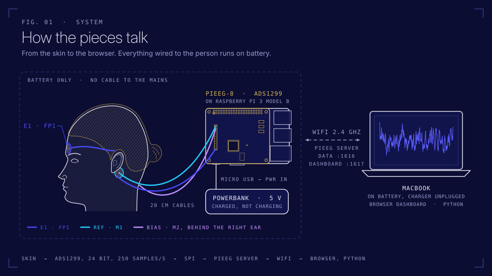
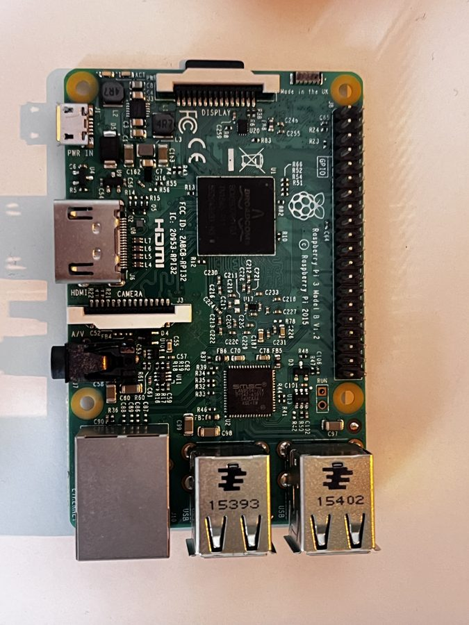
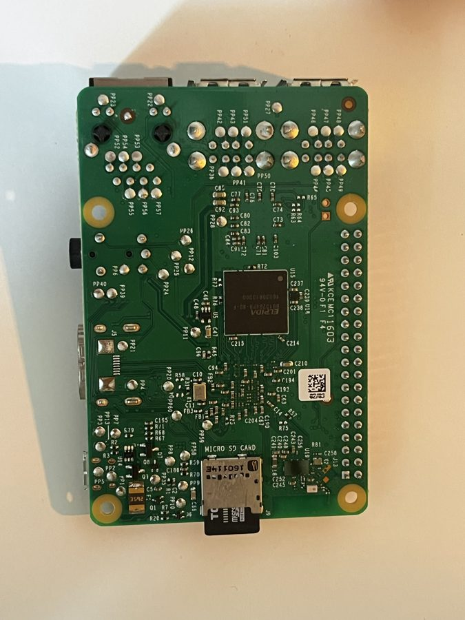
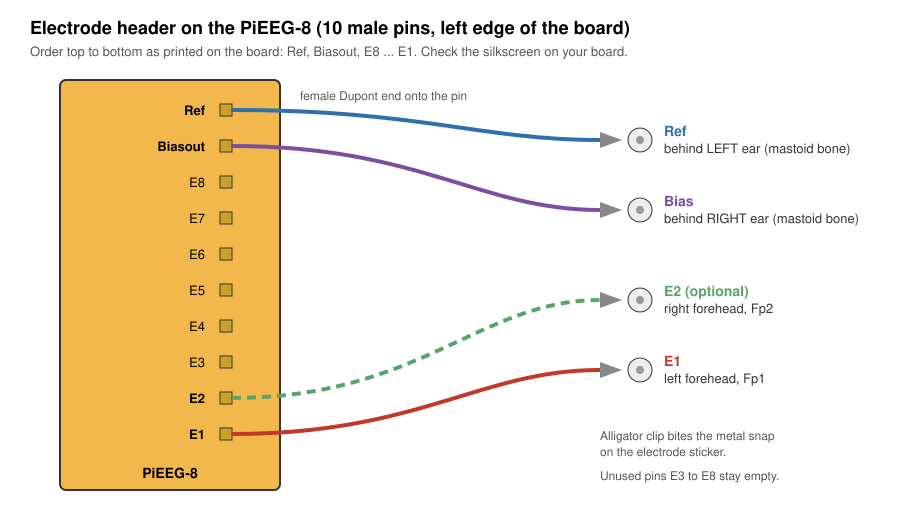
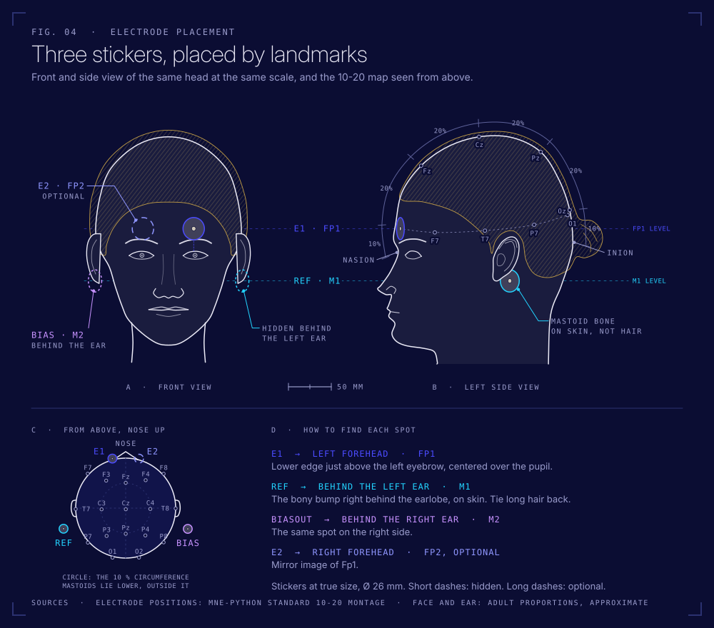

<div align="center">

# PiEEG Home Lab

**Your own 8-channel EEG on a Raspberry Pi. Stick, clip, plug in, see your brain.**



</div>

Everything in the box is already set up and tested. The first signal takes about 5 minutes. After that, the real fun is yours: filtering, spectra, your own alpha peak, and turning recordings into proper NWB files.

> [!CAUTION]
> **Battery only, always.** While electrodes are on your skin, the Raspberry Pi runs from the **powerbank** and your laptop runs **on battery with the charger unplugged**. Nothing on the setup is connected to a wall socket. The PiEEG board has no electrical isolation. Details in [docs/safety.md](docs/safety.md).

> [!NOTE]
> PiEEG is a research and education tool, **not a medical device**. Nothing it shows is a diagnosis.

---

## What's in the box

| | Part | Where it came from | What it does |
|---|---|---|---|
| 🟩 | **Raspberry Pi 3 Model B** (V1.2) with a 16 GB MicroSD, already set up | Jure's drawer | Runs PiEEG Server, streams data over WiFi |
| 🟧 | **[PiEEG-8 board](https://www.elecrow.com/pieeg.html)**: ADS1299, 24 bit, 250 Hz, 8 channels + Ref + Bias | Elecrow | The EEG amplifier. Sits on the Pi's 40 pin header |
| ⚪ | **[Ag/AgCl adhesive electrodes](https://shop.somnomedics.de/en/Single-adhesive-electrode-Ag-AgCl-foam-2.6-cm-OE/SEN010C)**, 2.6 cm, snap button, 2 packs × 30 (SEN010C) | Somnomedics | Single use stickers for forehead and behind the ears |
| 🐊 | **[Dupont female to alligator clip cables](https://www.berrybase.de/en/10pin-jumper/dupont-kabel-female-krokodilklemme-trennbar-20cm?c=338)**, 20 cm, 10 pcs (DUPAC20) | BerryBase | One per pin: female end onto the board, clip onto the sticker snap |
| 🔌 | **[Official Raspberry Pi Micro USB cable](https://www.berrybase.de/search?search=raspberry+pi+micro+usb+kabel)**, 1 m (RPI-MUSB-1) | BerryBase | Powerbank to Pi (port **PWR IN**) |
| 🔋 | **Powerbank**, USB A port with at least 2.4 A | | The only power source while recording |
| 🧽 | Alcohol wipes, if they made it into the box | dm | Clean skin = clean signal |

You also need: your **MacBook** (on battery while recording) and a **2.4 GHz WiFi** network, since the Pi 3 can't see 5 GHz.

Your Raspberry Pi, top and bottom:

<p>


</p>

The 40 pin header (right edge, top photo) is where the PiEEG board goes. The MicroSD sits underneath.

---

## Quick start: first signal in 5 minutes

1. **Board on.** If it isn't already: Pi unplugged, press the PiEEG board straight down onto all 40 pins. It should cover the Pi like a lid.
2. **Stickers on.** Wipe the skin, let it dry. One sticker on the left forehead, one on the bony bump behind each ear.
3. **Clip.** Left forehead → **E1**. Behind left ear → **Ref**. Behind right ear → **Biasout**.
4. **Power.** Put the Pi and powerbank close to your head (the clip cables are 20 cm: shoulder, a shelf at head height, or the pillow if you lie down). Plug the powerbank into **PWR IN**. Wait about a minute until it has booted and joined the WiFi.
5. **Look.** On your MacBook (charger unplugged, same WiFi) open **http://raspberrypi.local:1617** in Safari or Chrome and click **Connect**.

Now blink. Big spikes. Close your eyes and relax for 20 seconds: a 10 Hz rhythm grows in the spectrum. That's your alpha rhythm. 🧠

Step by step with checks and what "good" looks like: **[docs/first-test.md](docs/first-test.md)**

### Where everything plugs in





---

## Coding on your MacBook

The Pi does the hardware. Your Python runs on the Mac and reads the live stream over WiFi.

**One time setup** (Terminal):

```bash
python3 --version          # need 3.10 or newer
```

If it's older or missing, install Python 3.12 from [python.org](https://www.python.org/downloads/macos/) (or `brew install python@3.12`). The `python3` that ships with Apple's developer tools is too old for NumPy 2.

```bash
git clone <this repo>
cd pieeg-home-lab/code
python3 -m venv .venv
source .venv/bin/activate
pip install -r requirements.txt
```

**Every time** (Terminal, inside `pieeg-home-lab/code`):

```bash
source .venv/bin/activate
python live_view.py                                     # window with live traces + spectrum
python record.py --seconds 60 --label eyes_closed       # saves recordings/*.csv
python spectrum.py recordings/*eyes_open.csv recordings/*eyes_closed.csv
```

The first time Python talks to the Pi, macOS may ask **"Allow Python to find devices on your local network?"**. Click **Allow**, otherwise nothing connects. If you missed it: System Settings → Privacy & Security → Local Network → turn on Terminal (and Python).

No hardware nearby? Run the simulator in one Terminal tab and point everything at `localhost` in another (⌘T for a new tab):

```bash
python simulate.py                     # tab 1: fake PiEEG with alpha, blinks and 50 Hz hum
python live_view.py --host localhost   # tab 2
```

| File | What it is |
|---|---|
| [`code/eeg_stream.py`](code/eeg_stream.py) | Small client for the PiEEG Server WebSocket (`ws://raspberrypi.local:1616`) |
| [`code/live_view.py`](code/live_view.py) | Live filtered traces and a running spectrum |
| [`code/record.py`](code/record.py) | Records to CSV plus a JSON sidecar with the metadata |
| [`code/spectrum.py`](code/spectrum.py) | Welch spectrum, alpha peak frequency and power |
| [`code/simulate.py`](code/simulate.py) | Fake server with realistic test signals |
| [`code/mission_1_notch.py`](code/mission_1_notch.py) | Mission 1, with an automatic PASS/FAIL check |
| [`code/mission_3_nwb.py`](code/mission_3_nwb.py) | Mission 3 skeleton: CSV to NWB |

---

## Missions 🎯

| # | Mission | Done when |
|---|---|---|
| 1 | **Kill the 50 Hz hum** | `mission_1_notch.py` prints PASS twice |
| 2 | **Find your alpha peak** | You know your own alpha frequency to 0.5 Hz, eyes open vs closed |
| 3 | **Make it NWB** | Your recording passes `nwbinspector` with no errors |
| 4 | **Go beyond the forehead** | Two more channels, and alpha is clearer than at Fp1 |
| 5 | **Read the datasheet** | You can explain every step from 3 raw bytes to one µV value |

Details, hints and bonus ideas: **[docs/missions.md](docs/missions.md)**

---

## Docs

| | |
|---|---|
| [First test](docs/first-test.md) | The 5 minute start, with checks |
| [Safety](docs/safety.md) | The few rules that matter |
| [Raspberry Pi setup](docs/setup-raspberry-pi.md) | How the MicroSD was prepared, to redo it from scratch |
| [Missions](docs/missions.md) | What to build next |
| [Troubleshooting](docs/troubleshooting.md) | Flat lines, noise, WiFi, Pi 3 specifics |

## Built on

- [PiEEG](https://github.com/pieeg-club/PiEEG) hardware and Python SDK by Ildar Rakhmatulin and contributors
- [PiEEG Server](https://github.com/pieeg-club/PiEEG-server): dashboard, WebSocket stream, recording
- [PiEEG docs](https://docs.pieeg.com/hardware/devices/pieeg-8/)

This repo is an unofficial starter kit and is not affiliated with PiEEG. Code here is MIT licensed.

<div align="center">

Merry Christmas 🎄

</div>
