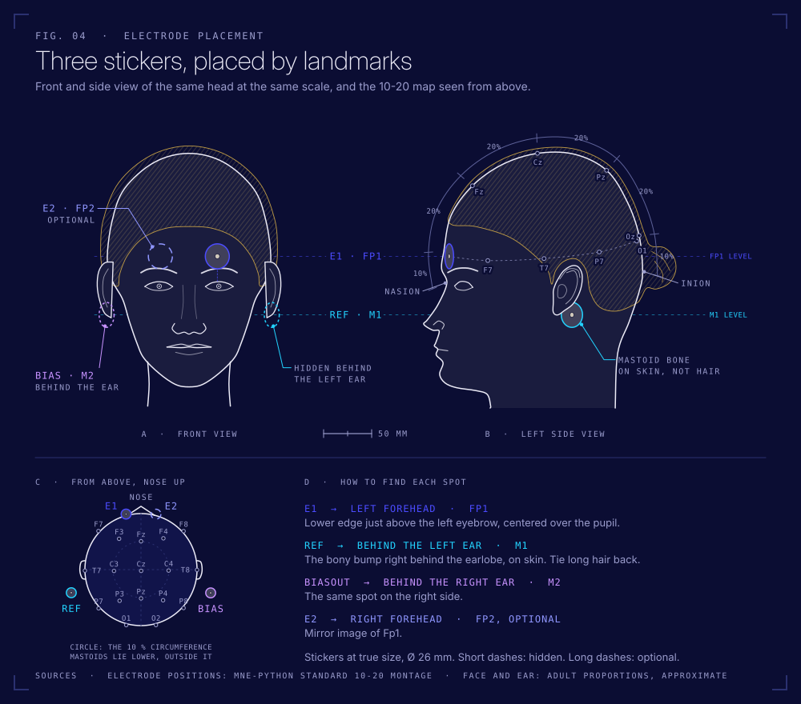
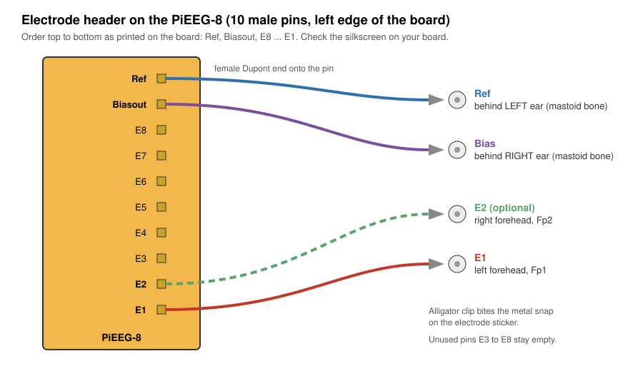

# First test

Goal: see a blink and your alpha rhythm in the browser. About 5 minutes.

## You need

- Raspberry Pi 3 Model B with the PiEEG-8 board on top and the MicroSD inside
- 3 electrode stickers, 3 alligator clip cables
- Powerbank (charged) and the Micro USB cable
- MacBook on battery, **charger unplugged**, on the same WiFi as the Pi (2.4 GHz)
- An alcohol wipe

## 1. Check the board

Pi unplugged. The PiEEG board sits on all 40 pins of the Pi's GPIO header, pushed down evenly, no pins visible on either side. If you take it off and on again, pull and push straight, never at an angle.

## 2. Electrodes

1. Wipe the left forehead and the bony bump behind both ears. Let it dry for 30 seconds.
2. Stick one electrode on the **left forehead** (Fp1), about two fingers above the eyebrow.
3. Stick one on the **bump behind the left ear** and one **behind the right ear**. Skin, not hair.
4. Press each sticker for a few seconds.

## 3. Clips

| Sticker | Clip goes to pin |
|---|---|
| Left forehead | **E1** |
| Behind left ear | **Ref** |
| Behind right ear | **Biasout** |

The female end of each cable slides onto a pin of the 10 pin header. The alligator clip bites the metal snap on the sticker. Let the cables hang loosely, without pulling on the stickers.

## 4. Where to put the Pi

The clip cables are 20 cm, so the Pi has to be near your head. Short is good: less wire, less hum.

- **Sitting:** Pi and powerbank on a shelf or a stack of books at shoulder height, or in a small pouch on your shoulder
- **Lying down:** Pi on the pillow next to your head. Best position for relaxed alpha
- Cables hang loose, nothing pulls on a sticker

## 5. Power and connect

1. Plug the Micro USB cable into the Pi (port labelled **PWR IN**) and into the powerbank.
2. The red LED on the Pi lights up. Wait about 60 seconds.
3. On the MacBook open **http://raspberrypi.local:1617** in Safari or Chrome and click **Connect**.

Doesn't load? See [troubleshooting](troubleshooting.md#the-dashboard-does-not-open).

## 6. What good looks like

Sit still, relax your jaw, look at one point.

| Do this | You should see on channel 1 |
|---|---|
| Sit still, eyes open | A wiggly line, roughly ±10 to ±50 µV after filtering |
| Blink hard | A big spike, often 100 µV or more |
| Clench your jaw | A burst of fast, fuzzy noise (that's muscle, EMG) |
| Close your eyes, relax 20 s | A rounder rhythm around 10 Hz, a bump at 8 to 13 Hz in the spectrum |

In the dashboard, turn on the **band-pass filter** (1 to 40 Hz) and the **notch filter at 50 Hz** (Germany runs at 50 Hz, not 60). Channels 2 to 8 have nothing connected and will look like noise. That's normal.

> Alpha is strongest at the back of the head. On the forehead it's weaker, so give it 20 to 30 seconds with eyes closed. Mission 4 is about getting a better spot.

## 7. Done for today

1. Unplug the powerbank.
2. Unclip, peel off the stickers and throw them away. They're single use.
3. Recharge the powerbank.

Next: record yourself with `code/record.py` and start [Mission 1](missions.md).
