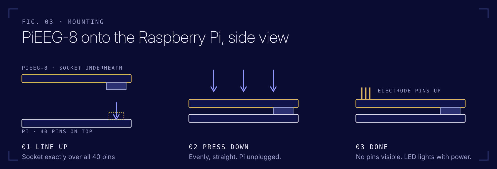
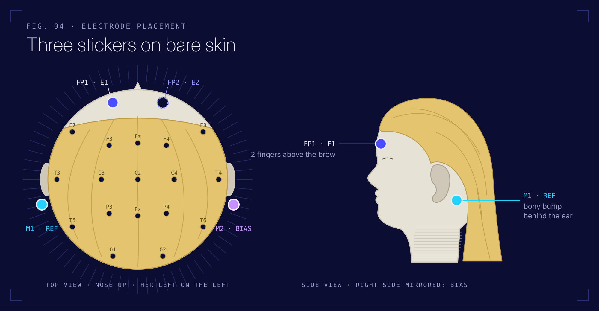
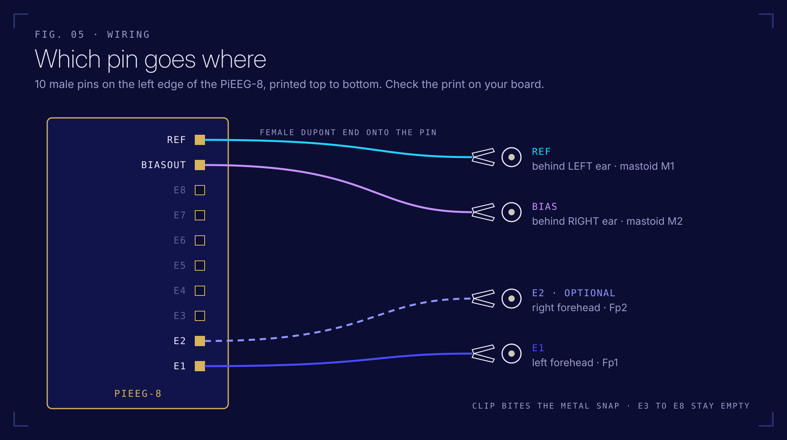

# First test

Goal: see a blink and your alpha rhythm in the browser. About 10 minutes. Based on the official [PiEEG-8 How to Start](https://docs.pieeg.com/hardware/devices/pieeg-8/setup/), adapted to the stick-on electrodes in this kit.

## You need

- Raspberry Pi 3 Model B with the PiEEG-8 on top and the MicroSD inside
- 3 electrode stickers, 3 alligator clip cables
- Powerbank, **charged and not plugged into the wall**, and the Micro USB cable
- MacBook on battery, **charger unplugged**, on the same WiFi as the Pi
- An alcohol wipe

## 1. Check the board

Pi unplugged. The PiEEG-8 sits on all 40 pins of the Pi's GPIO header, pushed down evenly, no pins visible at either end. Never put it on or take it off while the Pi has power. Hold it by the edges.



## 2. Electrodes



1. Wipe the left forehead and the bony bump behind both ears. Let it dry for 30 seconds.
2. Stick one electrode on the **left forehead** (Fp1), about two fingers above the eyebrow.
3. Stick one on the **bony bump behind the left ear** and one **behind the right ear** (mastoids, M1 and M2). Skin, not hair.
4. Press each sticker for 5 seconds.

**Why behind the ears and not on the earlobes?** The official PiEEG setup uses ear clips on the earlobes for Ref and Bias. A 2.6 cm sticker doesn't fit an earlobe, and the mastoid bone right behind it is the other standard reference site in EEG (M1, M2). Same job, better grip.

## 3. Clips



| Sticker | Clip goes to pin |
|---|---|
| Left forehead | **E1** |
| Behind left ear | **Ref** |
| Behind right ear | **Biasout** |

The black female end of each cable slides onto a pin of the 10 pin header. The alligator clip bites the metal snap in the middle of the sticker. Ref and Bias matter most: if one of them is loose, every channel gets noisy.

## 4. Where to put the Pi

The clip cables are 20 cm, so the Pi sits near your head. Short is good: less wire, less hum.

- **Sitting:** Pi and powerbank on a shelf or a stack of books at shoulder height, on a wooden or plastic surface
- **Lying down:** Pi on the pillow next to your head. Best position for relaxed alpha
- Cables hang loose, nothing pulls on a sticker

## 5. Power

1. Plug the Micro USB cable into the Pi (port **PWR IN**) and into the powerbank.
2. The red LED on the Pi and the LED on the PiEEG-8 light up. Wait about 60 seconds for the Pi to boot and join the WiFi.

## 6. Board self-test (optional, 10 seconds)

```bash
cd pieeg-home-lab/code && source .venv/bin/activate
python self_test.py
```

Every channel under 5 µV RMS means the board is healthy. This is PiEEG's official noise check: the chip shorts its own inputs, so the result doesn't depend on the stickers.

## 7. Open the dashboard

1. On the MacBook open **http://raspberrypi.local:1617** in Safari or Chrome and click **Connect**.
2. Check that the dashboard shows **8 channels**. Sixteen means the server isn't in PiEEG-8 mode, see [troubleshooting](troubleshooting.md#pieeg-server).
3. Click **Bandpass** → **Enabled** (1 to 40 Hz is the default).
4. Click **Notch** → choose **50 Hz** → **Enabled**. The dashboard defaults to 60 Hz (USA). Germany runs at 50 Hz.

Doesn't load? See [troubleshooting](troubleshooting.md#the-dashboard-does-not-open).

## 8. What good looks like

Sit still, relax your jaw, look at one point. Watch channel 1.

| Do this | You should see on channel 1 |
|---|---|
| Sit still, eyes open | A small wiggly line, roughly ±10 to ±50 µV |
| Blink hard | A large slow spike, often 100 µV or more |
| Look left, then right | Slow steps up and down: eye movement (EOG) |
| Clench your jaw | A burst of fast, fuzzy noise: muscle (EMG), not brain |
| Close your eyes, relax 20 to 30 s | A rounder rhythm around 10 Hz, a bump at 8 to 13 Hz in the spectrum |

Channels 2 to 8 have nothing connected and look like noise. That's normal.

> Alpha is strongest at the back of the head (O1, O2), where this kit has no electrode. On the forehead it's weaker, so give it time and watch the spectrum. Blinks, eye movements and jaw clenches are your first proof that the system records real biosignals.

## 9. Done for today

1. Unplug the powerbank.
2. Unclip, peel off the stickers and throw them away. They're single use.
3. Recharge the powerbank (with nothing connected to the Pi).

Next: record yourself with `code/record.py` and start [Mission 1](missions.md).
