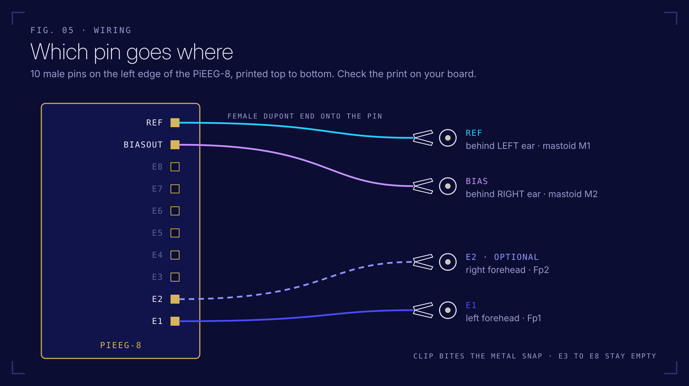

# How it works

From a voltage on your forehead to a number in Python.

## Signal chain

```
 scalp ── Ag/AgCl sticker ── alligator cable ──► PiEEG-8 ─────────────────────► Raspberry Pi 3 ──── WiFi ────► MacBook
 (~10 µV)                     20 cm              ADS1299                SPI0      PiEEG Server                  Python / browser
                                                 · subtracts Ref                  · reads 27 bytes per sample    · live_view.py
                                                 · gain                           · converts to µV               · record.py
                                                 · 24 bit ADC @ 250 Hz            · JSON over WebSocket :1616    · dashboard :1617
                                                 · drives Bias                    · dashboard on :1617
```



<sub>This kit uses stick-on electrodes: one on the forehead (E1), Ref and Bias behind the ears. The official PiEEG wiring is the same, with a cap and ear clips instead.</sub>

## Reference and bias

Every channel measures the **difference** between its electrode and **Ref**. If Ref is noisy, every channel is noisy, so Ref and Bias stickers matter most.

**Bias** actively drives the body to cancel common-mode noise, the part that appears on all electrodes at once, mainly 50 Hz mains hum (PiEEG: [Electrodes & Pinout](https://docs.pieeg.com/hardware/devices/pieeg-8/connections/)). In the register setup, **Ref** is the ADS1299's SRB1 input, shared by all channels (`MISC1 = 0x20`).

## Raspberry Pi pins used


| Header pin | GPIO | Signal | Direction |
|---|---|---|---|
| 19 | GPIO 10 | SPI0 MOSI | Pi → ADS1299 |
| 21 | GPIO 9 | SPI0 MISO | ADS1299 → Pi |
| 23 | GPIO 11 | SPI0 SCLK | Pi → ADS1299 |
| 24 | GPIO 8 | SPI0 CE0 | Pi → ADS1299 |
| 37 | GPIO 26 | DRDY, low when a sample is ready | ADS1299 → Pi |

Power and ground come from the header too. Source: [PiEEG pinout](https://docs.pieeg.com/hardware/devices/pieeg-8/connections/#raspberry-pi-pinout).

## One sample on the wire

Each time DRDY goes low (250 times a second), the Pi reads **27 bytes**:

| Bytes | Content |
|---|---|
| 0 to 2 | Status word, normally `0xC0 0x00 0x08` |
| 3 to 5 | Channel 1, 24 bit two's complement |
| ... | ... |
| 24 to 26 | Channel 8 |

PiEEG Server turns each 3 byte value into microvolts and broadcasts JSON. The exact formula and register settings: [PiEEG specification](https://docs.pieeg.com/hardware/devices/pieeg-8/specification/) and [ADS1299 datasheet](https://www.ti.com/lit/ds/symlink/ads1299.pdf). Checking that math is [Mission 5](missions.md#mission-5-read-the-datasheet).

## Data formats in this repo

**Live stream** (`ws://raspberrypi.local:1616`), one message per sample:

```json
{ "t": 1766686800.123456, "n": 42, "channels": [12.34, -5.67, 8.90, 0.12, 3.45, -1.0, 2.2, 0.8] }
```

| Field | Meaning |
|---|---|
| `t` | Unix time in seconds |
| `n` | Sample counter. A jump means samples were dropped |
| `channels` | µV, channel 1 to 8 |

**Recording** (`code/record.py`): `recordings/<YYYYMMDD_HHMMSS>_<label>.csv`

```
t,n,ch1,ch2,ch3,ch4,ch5,ch6,ch7,ch8
1766686800.123456,0,12.34,-5.67,...
```

plus a sidecar `…_<label>.json`:

```json
{
  "label": "eyes_closed",
  "start_time": "2026-12-25T19:00:00",
  "sample_rate_hz": 250,
  "n_samples": 15000,
  "n_channels": 8,
  "units": "microvolts",
  "source": "PiEEG Server @ raspberrypi.local",
  "dropped_sample_gaps": 0,
  "electrodes": { "ch1": "Fp1 (left forehead)", "ref": "left mastoid", "bias": "right mastoid" }
}
```

Edit `electrodes` in `record.py` when you move stickers. [Mission 3](missions.md#mission-3-make-it-nwb) turns CSV + JSON into an NWB file.

## Electrode positions (10-20 system)


<sub>Image: PiEEG docs.</sub>

PiEEG's default 8 channel montage: Fp1, Fp2, C3, C4, P7, P8, O1, O2. This kit starts with Fp1 (and optionally Fp2) because those are on skin without hair.

## Blueprints and primary sources

| | |
|---|---|
| PiEEG-8 specification, data frame, registers | [docs.pieeg.com · specification](https://docs.pieeg.com/hardware/devices/pieeg-8/specification/) |
| Official quick start manual (PDF) | [GitHub · PiEEG-8](https://github.com/pieeg-club/PiEEG-8/blob/main/Manual.%20Conenction%20and%20start%20-%20PiEEG1.pdf) |
| Official Python SDK (register setup, raw SPI reads) | [GitHub · PiEEG-8/1.GUI](https://github.com/pieeg-club/PiEEG-8/tree/main/1.GUI) |
| PiEEG Server source | [GitHub · PiEEG-server](https://github.com/pieeg-club/PiEEG-server) |
| ADS1299 datasheet | [Texas Instruments](https://www.ti.com/lit/ds/symlink/ads1299.pdf) |
| Original paper | I. Rakhmatulin, S. Völkl: *PIEEG: Turn a Raspberry Pi into a Brain-Computer-Interface to measure biosignals*, [arXiv:2201.02228](https://arxiv.org/abs/2201.02228) |
| 10-20 system | Jasper (1958), *The ten-twenty electrode system of the International Federation* |
